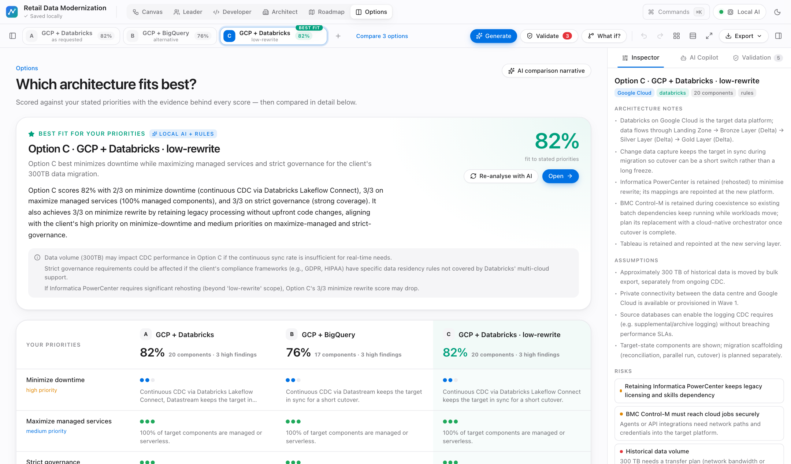
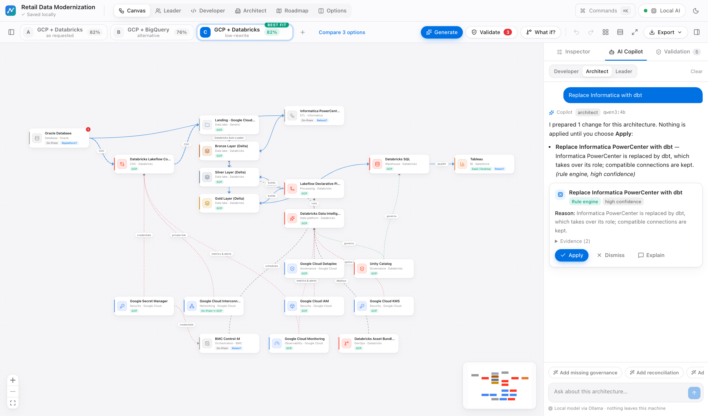

<div align="center">


# Migration Atlas

### Your legacy estate in. Your future architecture out.

A local AI-powered migration architecture studio. Describe your legacy estate — Oracle,
Informatica, Control-M, Teradata, mainframe — and get **several target architectures** on a
canvas that understands what every box means, scored against your priorities, validated,
and planned into migration waves.

**No OpenAI. No Claude. No Gemini. No cloud API. No API key.**
Ollama on your machine. Architecture data never leaves it.

[-00a07d?style=flat-square)](#local-ai)
[](#the-technology-ontology)
[](#how-the-ai-works)
[](#tests)
[](#architecture)
[](LICENSE)

*The Sunday Builds #14*

</div>

---

<div align="center">

<p><em>Three options for one estate — each scored against your priorities. Option C carries the best-fit badge.</em></p>
</div>

---

## The idea

> **Don't start your migration with a blank canvas.**

Diagramming tools understand boxes. Migration Atlas understands **what the boxes mean**:
Oracle is an OLTP database full of PL/SQL; Informatica is an ETL platform whose mappings hide
business logic; Control-M schedules work but doesn't move data; Unity Catalog governs a lakehouse.

So you describe the estate in a sentence —

> *"Oracle, Informatica PowerCenter, Control-M and Tableau, ~300 TB. Move to GCP and Databricks
> with minimal downtime."*

— and it lays out real alternatives, tells you which fits your priorities best and **why**, warns
you about connections that don't make sense, and plans the migration in waves.

```
 your estate ─► rules ─► ontology ─► knowledge graph ─► docs (RAG) ─► local LLM ─► validator ─► canvas
                (243 technologies · 169 connection rules · 55 migration mappings · 19 playbooks)
```

The model never draws the diagram and never edits it silently. Rules build it, AI reviews and
explains it, the validator checks it, and you decide.

---

## What it does

| | |
|---|---|
| 🧭 **Several architectures, every time** | The target you asked for, an alternative data platform and a low-rewrite coexistence path — side by side as tabs. Never one opinion dressed up as the answer. |
| ⭐ **Best fit, with evidence** | Each option scored 0–3 per priority (downtime, rewrite, managed ops, lock-in, licensing, governance…). Every score shows the evidence. Local AI recommends one — and says when each alternative wins instead. |
| 🎨 **A canvas that knows things** | Drag from 243 technologies. Drop Oracle and it suggests Lakeflow Connect, Datastream, GoldenGate. Drop GCP and it offers GCS, Pub/Sub, BigQuery. |
| 🔗 **Connection intelligence** | Every edge is `VALID`, `VALID_WITH_WARNING`, `UNUSUAL`, `INVALID` or `UNKNOWN`, with the reason. *Control-M → GCS?* "A scheduler, not a data transport." |
| 💬 **Ask anything** | Questions get cited answers. *"Replace Informatica with dbt"* returns an **Apply** card. *"What if we avoid Kafka?"* offers a branch. *"Which option is best?"* returns the fit analysis. |
| 🎓 **Expert playbooks** | 19 senior-architect playbooks (warehouse, Oracle, CDC & cutover, mainframe, platform choice, cost, governance…) picked per question and named under each answer. |
| 🛡️ **Deterministic validator** | Missing reconciliation, no rollback plan, no catalog, orphan components, wrong-cloud services — each finding with evidence and a one-click fix. Seven health dimensions, no vanity score. |
| 🗺️ **Roadmap & dependencies** | Twelve waves from Discovery to Decommissioning, ordered by a real dependency graph: *Oracle → Informatica → Tableau*, Control-M last. |
| 👥 **Three lenses** | Developer (mappings, protocols, validation steps), Architect (security, governance, DR, ADRs), Leader (themes, waves, risks, skills). |
| 📦 **Exports that travel** | PNG, SVG, Markdown, re-importable JSON and a PDF report with the diagram, mappings, decisions, risks, roadmap and references. |

---

## A tour

<table>
<tr>
<td width="50%"><br/><sub><b>Which architecture fits best?</b> A recommendation from local AI plus rules, and the evidence behind every score.</sub></td>
<td width="50%"><br/><sub><b>Ask anything.</b> "Replace Informatica with dbt" becomes a proposal you can apply, dismiss or have explained.</sub></td>
</tr>
<tr>
<td width="50%"><br/><sub><b>Validation & health.</b> Deterministic findings, explainable dimensions, one-click fixes.</sub></td>
<td width="50%"><br/><sub><b>Roadmap.</b> Waves ordered by the dependency graph, legacy → target.</sub></td>
</tr>
<tr>
<td width="50%"><br/><sub><b>Leader view.</b> Estate → target, themes, waves, risks and skills — no jargon.</sub></td>
<td width="50%"><br/><sub><b>Home.</b> The hero animation modernizes a legacy estate in place.</sub></td>
</tr>
</table>

---

## Quick start

```bash
git clone https://github.com/KrishnaRode/migration-atlas.git
cd migration-atlas
./start.sh
```

That's it. `start.sh` checks prerequisites, starts Ollama, creates the Python venv and installs
dependencies on first run, then starts the API (`:8014`) and the app (`:3014`) and opens your browser.
If Migration Atlas is already running it reuses it.

```bash
ATLAS_PULL_MODEL=1 ./start.sh            # also pull qwen3:4b if you have no model yet
API_PORT=8020 WEB_PORT=3020 ./start.sh   # different ports
make help                                # dev, test, smoke, typecheck, build
```

**Windows:** `start.bat`. **Docker (optional):** `docker compose up --build` (Ollama stays on the host).

### Requirements

- **Python 3.10–3.14** (3.12 recommended) and **Node.js 18.18+**
- **[Ollama](https://ollama.com/download)** with any capable model — `qwen3:4b`, `llama3.1:8b`, `mistral`, `gemma3`.
  The app runs without it; AI features then show setup steps and everything rule-based keeps working.

### Two-minute demo

Click **Explore Sample Estate** (*Oracle + Informatica + Control-M + Tableau → GCP + Databricks, minimal downtime*):

1. Three options appear as tabs; open **Options** to see which fits best and why.
2. Drag **Pub/Sub** onto the canvas and connect Lakeflow Connect → Pub/Sub — the inspector says `VALID` and why.
3. **Ask AI to explain** the connection — a streamed, cited answer.
4. Type *"Replace Control-M with Databricks Workflows"* — apply the proposal.
5. **Validate** — *No reconciliation* is flagged; **Apply** the fix.
6. Switch to **Leader**, **Generate migration roadmap**, then **Export → PDF**.

Four more sample estates ship in [`sample-estates/`](sample-estates): Teradata → Azure Databricks,
Oracle/SSIS/SQL Server → Azure, DB2/COBOL/CICS → AWS, Netezza → BigQuery.

---

## How the AI works

Everything is detailed in **[docs/ai.md](docs/ai.md)**. In short:

- **Hybrid pipeline.** Rules and the ontology build each option; the local model reviews it (every
  component it suggests is checked against the ontology), writes notes, assumptions and risks, and
  recommends a best fit over a deterministic fit table. Coordinates always come from ELK, never the model.
- **Intent routing.** Free text is classified as a question, a change, a what-if or a recommendation
  and handled by the capability built for it — so "add DR" produces an applyable change, not an essay.
- **Grounding.** Each answer gets the architecture, validation findings, estate, ontology facts,
  knowledge-graph context, the most relevant playbook and cited documentation passages.
- **Small-model robustness.** Thinking-only models (qwen3 2507) are run in JSON mode and streamed;
  narration and question-echoes are stripped; weak answers are retried differently; every call has
  a hard deadline.
- **Measured.** [`scripts/eval_ai.py`](scripts/eval_ai.py) runs 20 representative questions against
  your local model and checks routing, actions, playbook choice, concepts, leakage, length and latency.
  The iteration history is in [docs/ai.md](docs/ai.md#6-evaluation).

### Local AI

| Step (qwen3:4b, M4 MacBook) | Time |
|---|---|
| Options without AI · validation · roadmap · exports | under a second |
| Three options with AI review + best-fit recommendation | ~35 s |
| Change requests (rule-backed proposals) | instant – ~45 s |
| Questions and what-ifs (streamed, cited) | ~25–55 s |

Pick any installed model in **Settings**. Optional: `ollama pull nomic-embed-text` for semantic search.

---

## The technology ontology

Everything the app knows is plain YAML you can read and extend — [docs/ontology.md](docs/ontology.md):

| | |
|---|---|
| [`ontology/technologies/`](ontology/technologies) | 243 technologies — legacy and modern, data and application, AWS/Azure/GCP, NoSQL, query engines, ELT SaaS, iPaaS, serverless, governance |
| [`ontology/connection_rules.yaml`](ontology/connection_rules.yaml) | 169 rules behind connection intelligence |
| [`ontology/mappings*.yaml`](ontology) | 55 source → target migration mappings with approaches, effort and risks |
| [`patterns/`](patterns) | 11 architecture patterns with diagram templates |
| [`knowledge/skills/`](knowledge/skills) | 19 expert playbooks |
| [`knowledge/seed/`](knowledge/seed) + [`sources.yaml`](knowledge/sources.yaml) | 41 curated notes + a registry of official docs (all disabled until you enable them; robots.txt and rate limits respected; no crawler) |

Add a technology, restart the API, and the library, suggestions, rules, generator, validator,
playbook selection and knowledge graph all pick it up.

---

## Architecture

```
migration-atlas/
├── apps/
│   ├── web/                  Next.js 15 · React 19 · TypeScript · Tailwind v4 · React Flow · ELK · zustand
│   └── backend/atlas/        FastAPI · Pydantic
│       ├── ontology/         YAML loader, integrity checks, search, typo-tolerant matching
│       ├── rules/            connection intelligence · validator · health dimensions
│       ├── architecture/     generator · options & fit · ops · replace · what-if · compare
│       ├── migration/        dependency graph · roadmap
│       ├── ai/               Ollama client · intent router · copilot · prompts · estate parser
│       ├── knowledge/        source registry · controlled ingestion · BM25(+dense) store · graph · playbooks
│       └── export/           Markdown · PDF
├── ontology/  patterns/  knowledge/  sample-estates/
├── scripts/                  smoke_test.py · eval_ai.py
└── docs/                     ai.md · architecture.md · ontology.md
```

More in [docs/architecture.md](docs/architecture.md).

---

## Tests

```bash
make test                      # 75 backend (pytest) + 11 UI component (vitest)
make smoke                     # the full demo journey end to end, against a running API
python scripts/eval_ai.py      # 20-case copilot evaluation against your local model
```

Backend tests run with Ollama deliberately unreachable, so every AI path is proven to degrade
gracefully.

---

## Privacy

- Projects, the knowledge base and the graph live in `data/` on your machine (SQLite + JSON).
- The only outbound calls go to your local Ollama — and, only if you enable a documentation source,
  to that vendor's official docs.
- No telemetry, no accounts, no cloud AI.

---

## Roadmap

- Cost modelling per option, with explicit and editable assumptions
- Import from draw.io / Mermaid diagrams and CMDB exports
- Neo4j and Qdrant/Chroma adapters behind the existing interfaces
- Comments and review workflow on components and ADRs

## Contributing

Issues and PRs are welcome. The highest-leverage contributions are to the ontology and playbooks —
every feature reads from them. Please run `make test` (and `scripts/eval_ai.py` for prompt changes).

## License

[MIT](LICENSE) © Krishna Rode

<div align="center"><sub><b>The Sunday Builds #14</b> · Built to explore what local AI can do.</sub></div>
