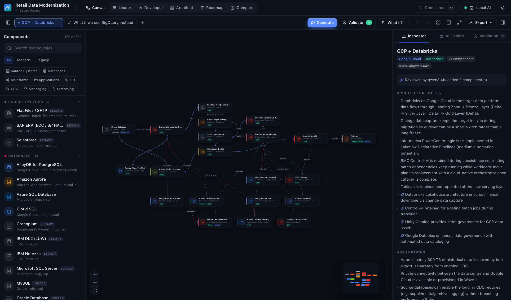
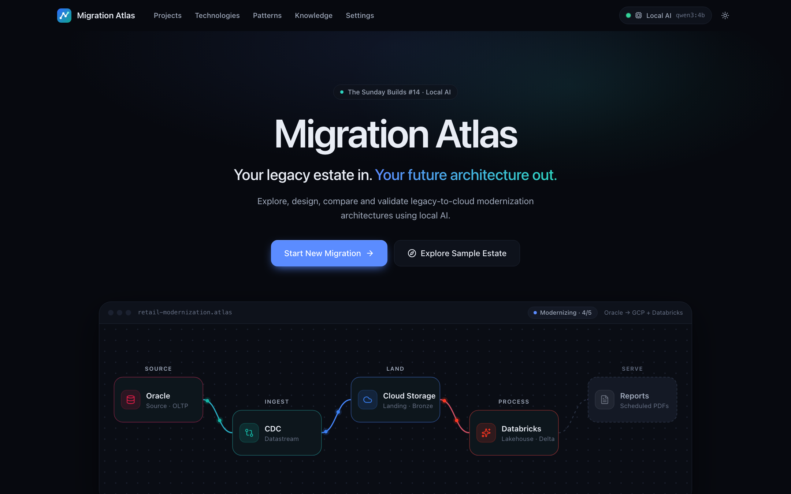
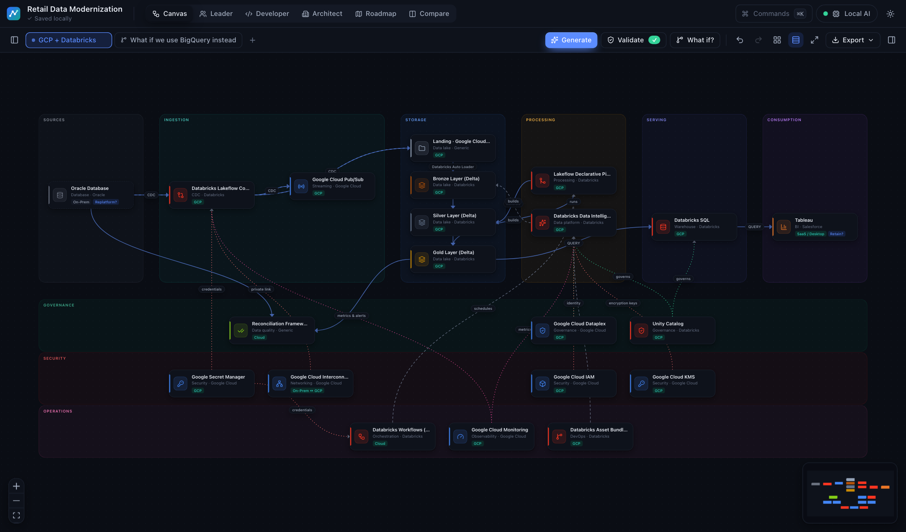
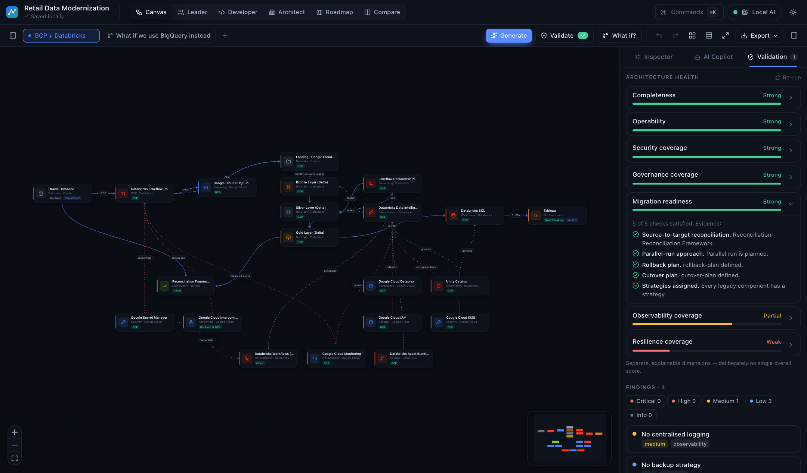
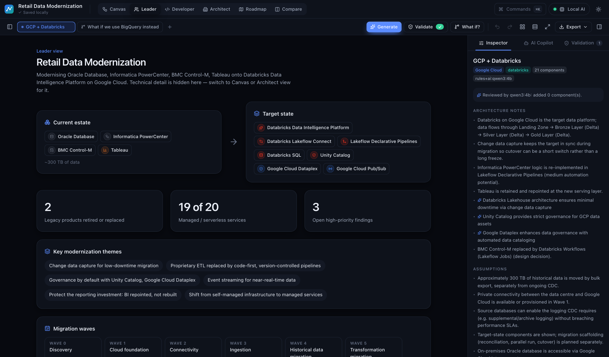
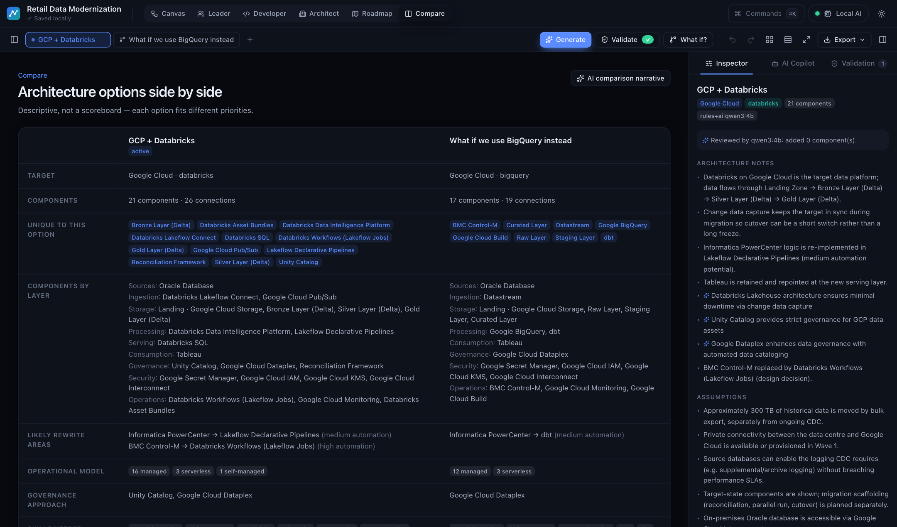
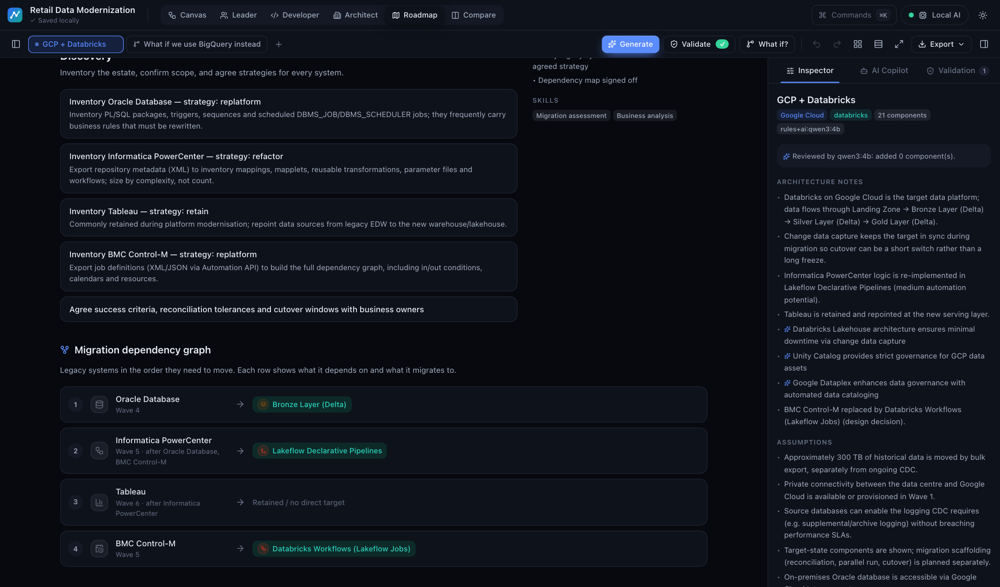

<div align="center">


# Migration Atlas

### Your legacy estate in. Your future architecture out.

A local AI-powered migration architecture studio for modernizing legacy estates.
Explore, design, compare and validate legacy-to-cloud architectures on a canvas that
**understands what the boxes mean** — powered by Ollama on your own machine.

**No OpenAI. No Claude. No Gemini. No API keys. Architecture data stays local.**

[-0fa68f?style=flat-square)](#local-ai)
[](#technology-ontology)
[](#tests)
[](#architecture)
[](LICENSE)

*The Sunday Builds #14 · Built to explore what local AI can do.*

</div>

---



## What is Migration Atlas?

> **Don't start your migration with a blank canvas.**
> Describe your legacy estate. Migration Atlas maps it, modernizes it, and helps you design what comes next.
> **Locally. Visually. Explainably.**

Migration Atlas is an interactive architecture studio for modernization work. You describe the estate
(*"Oracle, Informatica PowerCenter, Control-M, Tableau, ~300 TB, moving to GCP and Databricks, minimal
downtime"*), and it generates a target architecture you then refine on a canvas: drag components in,
connect them, swap technologies, ask questions, validate, branch what-ifs, compare options, plan
migration waves and export the result.

The canvas is the product — not a chatbot. AI helps where it adds value, and never changes the
canvas without showing you a proposal first.

## Why it exists

Traditional diagramming tools understand boxes. Migration Atlas understands what the boxes mean:

- **Oracle** is an OLTP database with PL/SQL, and commonly migrates to Databricks, AlloyDB or Aurora.
- **Informatica** is an ETL platform whose mappings hide business logic.
- **Control-M** orchestrates workloads — it is *not* a data transport, so `Control-M → GCS` earns a warning.
- **Kafka** provides streaming; **Databricks** provides a lakehouse; **Unity Catalog** provides governance.

That knowledge lives in a **technology ontology** (YAML, 172 technologies, 169 connection rules,
35 migration mappings, 11 architecture patterns, 25 risks) and drives every feature: suggestions,
connection intelligence, generation, validation, roadmap and the AI's context.

## Screenshots

| | |
|---|---|
|  |  |
| **Landing** — the hero animation modernizes a legacy estate | **Canvas** with swimlanes, medallion stack and cross-cutting rows |
|  |  |
| **Validation & health** — explainable dimensions, no single score | **Leader view** — estate → target, themes, waves, risks, skills |
|  |  |
| **Compare** — descriptive, side by side, no "winner" | **Roadmap** — 12 waves ordered by the dependency graph |

## Features

**Describe → Generate → Drag → Connect → Validate → Improve → Compare → Plan → Export**

- **Estate intake** — natural language *and* visual pickers, kept in sync. Rules extract technologies,
  constraints, volumes and industry instantly; local AI refines.
- **AI architecture generation** — a hybrid pipeline (below). Structured JSON first; layout is computed
  with **ELK**, never by the model.
- **Architecture canvas** (React Flow) — drag & drop, zoom/pan, minimap, multi-select, grouping (⌘G),
  snapping, auto-layout (L), swimlanes, editable connections, undo/redo, duplicate (⌘D), delete,
  fit (F), full screen, component search and category filtering, right-click menus, ⌘K command palette.
- **Connection intelligence** — every edge is `VALID`, `VALID_WITH_WARNING`, `UNUSUAL`, `INVALID` or
  `UNKNOWN`, with the reason and the rule that matched. Experiments are allowed; nonsense is explained.
- **Smart suggestions** — drop Oracle and get Lakeflow Connect, Datastream, GoldenGate…; drop GCP and get
  GCS, Pub/Sub, BigQuery, Dataflow, Composer, Secret Manager, Monitoring.
- **Replace with…** — ontology-ranked alternatives; compatible connections are preserved, the operational
  change is described, and the copilot explains it for your persona. One click records an **ADR**.
- **AI copilot** — persona-aware (Developer / Architect / Leader), grounded in the architecture JSON,
  ontology facts, knowledge-graph neighbourhood, validation findings and retrieved documentation,
  with **citations**. Answers use *Recommendation · Why · Evidence · Assumptions · Alternatives · Risks*.
- **AI actions** — "Add missing governance", "Add reconciliation", "Add a streaming layer",
  "Reduce infrastructure complexity"… Proposals come from the rule engine and the local model, and
  are only applied when you click **Apply**.
- **Deterministic validator** — data, governance, security, reliability, observability, migration and
  architecture rules with Critical → Info severities, shown on the graph, each with evidence and (where
  mechanical) a ready-made fix.
- **Health panel** — completeness, operability, security, governance, migration readiness,
  observability and resilience, each explainable check by check. Deliberately no overall score.
- **What-if branches** — *"What if we use BigQuery instead?"*, *"…avoid Kafka?"*, *"…downtime under 30
  minutes?"*. Every scenario is a new option; the original is never touched.
- **Compare** options on components, rewrite areas, operating model, governance, skills, complexity,
  dependencies and risks.
- **Migration strategies** (the 8 R's) per system — suggested, but always your call.
- **Source-to-target mappings**, **migration dependency graph** and a **12-wave roadmap**
  (Discovery → Decommissioning) ordered by dependencies.
- **Persona views** — Leader, Developer and Architect lenses on the same architecture.
- **Exports** — PNG, SVG, re-importable JSON, Markdown and a PDF report (title, executive summary,
  estate, target architecture + diagram, mappings, decisions, assumptions, risks, strategy, roadmap,
  validation, documentation references). ADRs export as Markdown.
- **Technology pages** for every component, a **pattern library** with diagram templates, and
  **global search** (*"Oracle to Databricks"* → mappings, patterns, docs, risks, graph path).

## Architecture

```
migration-atlas/
├── apps/
│   ├── web/                 Next.js 15 · React 19 · TypeScript · Tailwind v4 · React Flow · ELK · zustand
│   └── backend/atlas/       FastAPI · Pydantic
│       ├── ontology/        YAML loader, integrity checks, search, alias matching
│       ├── rules/           connection intelligence + deterministic validator & health
│       ├── architecture/    generator, graph ops, replacement, what-if, compare, patterns
│       ├── migration/       dependency graph + roadmap
│       ├── ai/              Ollama client, prompts, estate parser, AI review/proposals, copilot
│       ├── knowledge/       source registry, controlled ingestion, BM25(+dense) store, NetworkX graph
│       ├── export/          Markdown + PDF (ReportLab)
│       └── api/             routers
├── ontology/                technologies/*.yaml, connection_rules, platforms, mappings, risks, strategies
├── patterns/                11 architecture patterns with diagram templates
├── knowledge/               sources.yaml (registry) + 41 curated seed notes
├── sample-estates/          5 demo estates
├── scripts/smoke_test.py    the full demo journey, end to end
└── docs/
```

### The hybrid reasoning pipeline

```
 Estate ─▶ 1 Deterministic rules ─▶ 2 Ontology ─▶ 3 Knowledge graph ─▶ 4 RAG ─▶ 5 Ollama review ─▶ 6 Validation ─▶ ELK layout ─▶ Canvas
           (platform building        (legacy →    (MIGRATES_TO,         (cited     (JSON only; every id     (rule engine,
            blocks per cloud &        modern        REPLACES…)            passages)  checked against the       findings + fixes)
            data platform)            mappings)                                      ontology; rejected
                                                                                     suggestions reported)
```

The LLM is never the source of truth. It reviews a rules-based draft, can add at most a few
components that pass ontology checks, and contributes notes, assumptions and risks that are marked
as AI-authored in the UI. If Ollama is down or the output is unusable, you get the rules-based
architecture and a clear note — never a crash, never a stack trace.

See [docs/architecture.md](docs/architecture.md) for the full design.

## Local AI

Ollama is the only AI runtime. Installed models are discovered automatically; pick one in
**Settings**. Anything that handles structured output well works — Qwen, Llama, Mistral, Gemma, Phi.

Measured on an M4 MacBook (24 GB) with `qwen3:4b`:

| Step | Time |
|---|---|
| Architecture generation, rules only | < 0.5 s |
| Generation with local AI review | ~15–20 s |
| Copilot answer (streamed, with citations) | ~15–20 s |
| AI change proposals | ~15 s |
| Estate extraction (rules, live while typing) | instant |

> **qwen3 2507 note:** the current `qwen3:4b` tag is a thinking-only model that ignores
> `think: false` and narrates its reasoning. Migration Atlas detects the `thinking` capability via
> `/api/show` and streams the answer out of a JSON envelope instead, so you only see the answer.

Optional: `ollama pull nomic-embed-text` and select it in Settings to blend dense embeddings with
BM25 retrieval.

## Prerequisites

- **Python 3.10–3.14** (3.12 recommended)
- **Node.js 18.18+**
- **Ollama** — <https://ollama.com/download> (the app runs without it; AI features then show setup steps)
- ~700 MB disk for dependencies, plus your model (qwen3:4b ≈ 2.5 GB)

## Quick start

```bash
git clone https://github.com/KrishnaRode/migration-atlas.git
cd migration-atlas
./start.sh
```

`start.sh` checks prerequisites, starts Ollama if needed, creates the Python venv, installs
dependencies on first run, starts the API (`:8014`) and web app (`:3014`) and opens your browser.

```bash
ATLAS_PULL_MODEL=1 ./start.sh          # also pull qwen3:4b if no model is installed
API_PORT=8020 WEB_PORT=3020 ./start.sh # different ports
make dev | make test | make smoke      # see `make help`
```

**Windows:** run `start.bat` (opens two server windows and your browser).

**Docker (optional):** `docker compose up --build` — Ollama stays on the host and is reached via
`host.docker.internal`.

**Manual:**

```bash
ollama serve & ollama pull qwen3:4b
cd apps/backend && python -m venv .venv && .venv/bin/pip install -e ".[dev]"
.venv/bin/python -m uvicorn atlas.main:app --port 8014
cd apps/web && npm install && npm run dev        # http://localhost:3014
```

## The sample estate (demo in 2 minutes)

Click **Explore Sample Estate** on the home page — *Oracle + Informatica + Control-M + Tableau →
GCP + Databricks, minimum downtime*. Then:

1. Watch the target architecture generate (rules → ontology → graph → RAG → local AI → validation).
2. Drag **Pub/Sub** onto the canvas and connect Lakeflow Connect → Pub/Sub — the inspector shows `VALID` and why.
3. **Ask AI to explain** the connection — a streamed, cited answer.
4. Right-click **Control-M → Replace with… → Databricks Workflows**; the copilot explains what changes.
5. **Validate** — *No reconciliation* is flagged (high).
6. **Apply** the proposal — the reconciliation component appears; migration readiness improves.
7. Switch to the **Leader** view.
8. **Generate migration roadmap** — 12 waves, Oracle → Informatica → Tableau dependency order.
9. **Export** a PDF report and a PNG diagram.

The same journey runs headless: `python scripts/smoke_test.py` (11 steps, real local AI).
Four more samples ship in [sample-estates/](sample-estates): Teradata → Azure Databricks,
Oracle/SSIS/SQL Server → Azure, DB2/COBOL/CICS → AWS, Netezza → BigQuery.

## Documentation ingestion

The knowledge base starts with **41 curated notes** (original summaries, each linking to the official
page it summarises) so answers carry citations offline. You can add more:

- **Official docs** — [knowledge/sources.yaml](knowledge/sources.yaml) registers 19 sources (Google
  Cloud, AWS, Azure, Databricks, Snowflake, Oracle, Teradata, Informatica, IBM, SAP, PostgreSQL,
  Kafka, Airflow, Spark, Kubernetes, dbt, plus GitHub docs repos). **Every source ships disabled.**
  Ingestion only fetches registered seed pages or URLs under a source's `allowed_prefixes`, honours
  `robots.txt`, rate-limits per host, and refuses redirects outside the prefixes. There is no crawler.
- **Your documents** — drop PDF, HTML, Markdown or text files on the Knowledge page.

Each document stores vendor, product, URL, title, type, retrieval time, detected version, content
hash and extracted text. Retrieval is BM25 over SQLite (zero downloads), blended with cosine
similarity when an Ollama embedding model is selected. A NetworkX knowledge graph (Technology,
Capability, Vendor, MigrationPattern, Risk, ArchitecturePattern, Documentation; PROVIDES, REPLACES,
CONNECTS_TO, MIGRATES_TO, ALTERNATIVE_TO, DOCUMENTED_BY, REQUIRES…) is persisted as JSON behind a
`GraphStore` interface, ready for a Neo4j implementation.

## Technology ontology

Everything the app knows is editable YAML — see [docs/ontology.md](docs/ontology.md). Add a
technology, restart the API, and the library, suggestions, rules, generator, validator and graph pick
it up. The loader validates every cross-reference; the test suite fails on dangling ids.

## Tests

```bash
make test     # 58 backend tests (pytest) + 9 UI component tests (vitest)
make smoke    # 11-step end-to-end demo journey against a running API
make typecheck
```

Backend tests cover ontology loading and integrity, search, connection rules, generation for every
sample estate, validation and proposals, replacement, what-if, structured-output parsing, estate
extraction, project persistence, roadmap/dependencies, knowledge store and ingestion controls, exports
and every API endpoint — with Ollama deliberately unreachable, so all AI paths are proven to degrade.

## Privacy

- Architecture data stays on your machine: projects live in `data/atlas.db` (SQLite), the knowledge
  base in the same file, the graph in `data/knowledge_graph.json`.
- The only outbound requests are to your local Ollama, and — only if you enable a documentation
  source — to that vendor's official docs.
- No telemetry, no accounts, no cloud AI. Optional cloud providers are a possible future adapter,
  not part of this build.

## Roadmap

- Cost modelling per option (with explicit, editable assumptions)
- Neo4j `GraphStore` and Qdrant/Chroma vector adapters
- Import from existing diagrams (draw.io, Mermaid) and CMDB exports
- Multi-user review with comments on components and ADRs
- More ontology coverage: SAP, Hadoop ecosystems, iPaaS

## Contributing

Issues and PRs welcome. The highest-leverage contributions are ontology improvements — better
technologies, connection rules, mappings and patterns — because every feature reads from them.
Please run `make test` and keep YAML references valid.

## License

[MIT](LICENSE) © Krishna Rode

<div align="center"><sub>The Sunday Builds #14 · Built to explore what local AI can do.</sub></div>
